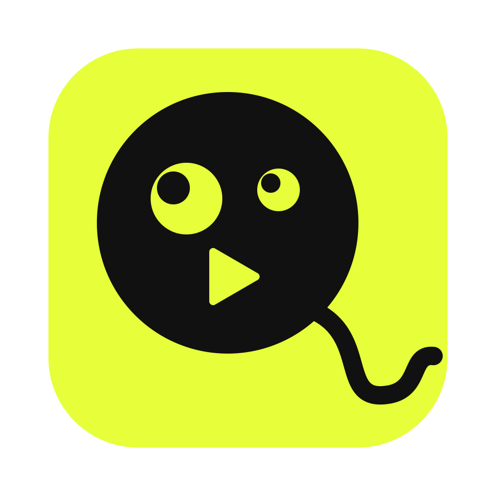
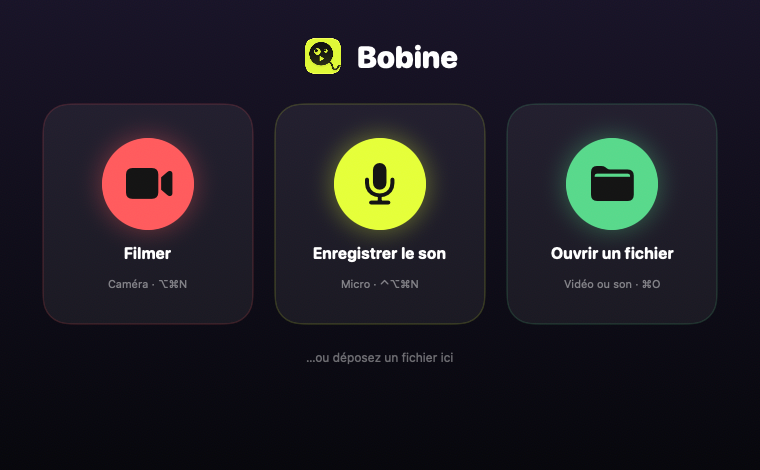
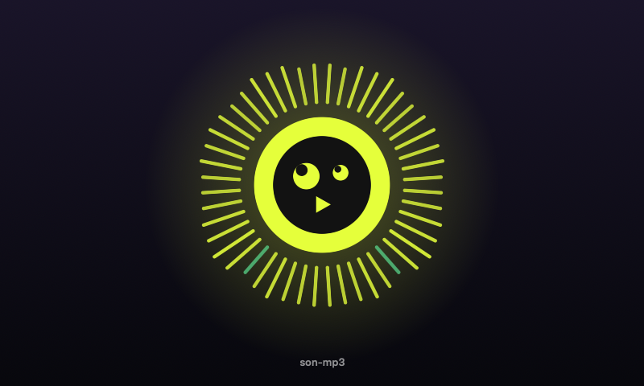

<p align="center"></p>

<h1 align="center">Bobine</h1>

<p align="center"><b>Lire toutes les vidéos, couper vite, filmer — une seule petite app pour Mac.</b><br>
<i>Play any video, cut it fast, record — one small Mac app.</i> (<a href="#english">English below</a>)</p>

<p align="center"></p>

Bobine remplace le duo QuickTime + VLC : elle lit tous les formats, permet un montage rapide
directement sous la vidéo, enregistre la caméra et le micro, et exporte avec ffmpeg.
L'original n'est jamais modifié : chaque export fabrique un nouveau fichier.

## Ce qu'elle fait

- **Lecture de tous les formats** : le moteur d'Apple (celui de QuickTime) pour les formats natifs, sinon
  le **moteur de VLC** (mkv, webm, avi, flv, wmv, VP9, AV1…), chargé depuis `/Applications/VLC.app`.
- **Mini-montage** sous la vidéo : vignettes et **forme d'onde du son** (on voit les silences entre les phrases).
  Glisser sur l'onde pour sélectionner, ⌫ pour supprimer, C pour couper. Les passages supprimés disparaissent
  de la bande ; la lecture les saute sans blanc (moteur Apple). Zoom au trackpad ou à la molette.
- **Recadrage** façon iPhone (16:9, 9:16, carré, 4:5…), rotation.
- **Filtres de couleur** façon iPhone (Éclatant, Spectaculaire, chaud/froid, Mono, Argentique, Noir) :
  l'aperçu et l'export utilisent exactement le même calcul.
- **Normaliser le son** à l'export (−16 LUFS, la norme des plateformes).
- **Appliquer** : rend le montage définitif dans un nouveau fichier, rouvert aussitôt.
- **Export** via ffmpeg et l'encodage matériel d'Apple : MP4 compatible, 1080p, 720p, HEVC, M4A, MP3.
- **Enregistrement** caméra et micro comme QuickTime : qualité Léger / Moyen / Maximum (chaque choix dit à quoi
  il sert : mail, réseaux sociaux, montage…), effets de macOS (mode Studio, Portrait, Isolation de la voix),
  filtres de couleur visibles en direct.
- **Fichiers son** : un visuel animé qui suit le volume, plutôt qu'un écran noir.
- **Plein écran** épuré (F), outils de montage repliables (T), interface qui s'adapte à la taille de la fenêtre.

<p align="center"></p>

## Installer

Il faut un Mac sous **macOS 15** ou plus récent, puis, une fois :

```bash
xcode-select --install          # outils de compilation d'Apple
brew install ffmpeg             # export, vignettes, forme d'onde
```

et [VLC](https://www.videolan.org/vlc/) dans `/Applications` (pour les formats non Apple).
Ensuite :

```bash
git clone https://github.com/tristanmf/bobine.git
cd bobine
bash construire-app.sh
```

L'app est installée dans `~/Applications/Bobine.app`. Pour en faire le lecteur par défaut d'un format :
clic droit sur un fichier › Lire les informations › Ouvrir avec : Bobine › Tout modifier.

L'app est signée localement (signature « ad hoc ») : macOS demande les autorisations caméra et micro au premier
usage, et peut les redemander après chaque reconstruction.

## Raccourcis

| Touche | Effet |
|---|---|
| espace | lecture / pause |
| C (ou B) | couper à la tête de lecture |
| ⌫ | supprimer la sélection, sinon le morceau courant |
| ← / → | ±5 s (⌥ : ±1 s, ⇧ : image par image) ; J / L : ±2 s |
| ↑ / ↓ | coupe précédente / suivante |
| fn + ← / fn + → | début / fin du montage |
| + / − | zoom de la bande |
| R | recadrer |
| F | plein écran |
| T | replier les outils de montage |
| ⌘Z / ⇧⌘Z | annuler / rétablir |
| ⇧⌘A | appliquer le montage (nouveau fichier) |
| ⌥⌘N / ⌃⌥⌘N | enregistrement vidéo / audio |

## Sous le capot

Swift et SwiftUI (Swift Package Manager, aucun projet Xcode). Rien n'est embarqué : Bobine utilise le VLC et le
ffmpeg déjà installés sur le Mac.

| Fichier | Rôle |
|---|---|
| `Lecture.swift` | contrôleur, moteurs de lecture (AVFoundation avec assemblage virtuel des morceaux gardés, ou VLC) |
| `MoteurVLC.swift` | libvlc chargée par `dlopen` depuis VLC.app |
| `BandeMontage.swift`, `Onde.swift`, `Montage.swift` | bande de montage, forme d'onde, modèle des coupes |
| `Filtres.swift`, `Recadrage.swift` | filtres de couleur (matrice commune aperçu / export), recadrage |
| `Export.swift` | ffmpeg (copie quand c'est possible, sinon réencodage matériel) |
| `Enregistrement.swift` | caméra et micro (AVCaptureSession) |
| `VueAccueil.swift`, `VueSon.swift` | accueil, visuel des fichiers son |

Diagnostic : `~/Library/Logs/Bobine.log`. Tests automatiques : voir `AGENTS.md`.

## Fabriquée avec l'IA

Bobine a été conçue par Tristan Mendès France et entièrement codée avec **Claude Code** (Anthropic),
un assistant de programmation par IA. Je ne suis pas développeur : le code a été testé à l'usage,
pas relu ligne à ligne par un professionnel.

## Licence

[MIT](LICENSE) — © 2026 Tristan Mendès France. VLC et ffmpeg restent sous leurs propres licences et ne sont pas
fournis avec Bobine.

---

## English

**Bobine** ("film reel" in French) is a small macOS app that replaces the QuickTime + VLC pair:

- plays **every format** (Apple's AVFoundation engine, or the **VLC engine** loaded from `/Applications/VLC.app`);
- **quick editing** right under the video, with a **waveform** to cut between sentences: drag to select,
  ⌫ to delete; deleted parts are skipped with no gap; nothing is ever written over the original;
- iPhone-style **crop** and **color filters**, **loudness normalization** (−16 LUFS);
- **export** through ffmpeg with Apple hardware encoding (MP4, 1080p, 720p, HEVC, M4A, MP3);
- **camera and microphone recording** like QuickTime, with Light / Medium / Maximum quality and live filters.

The interface is in French. Requirements: macOS 15+, Xcode command line tools, `brew install ffmpeg`,
VLC in `/Applications`. Build and install with `bash construire-app.sh` (installs `~/Applications/Bobine.app`).

**Built with AI.** Bobine was designed by Tristan Mendès France and entirely coded with **Claude Code**
(Anthropic), an AI programming assistant. I am not a developer: the code has been tested through use,
not reviewed line by line by a professional.

License: MIT.
